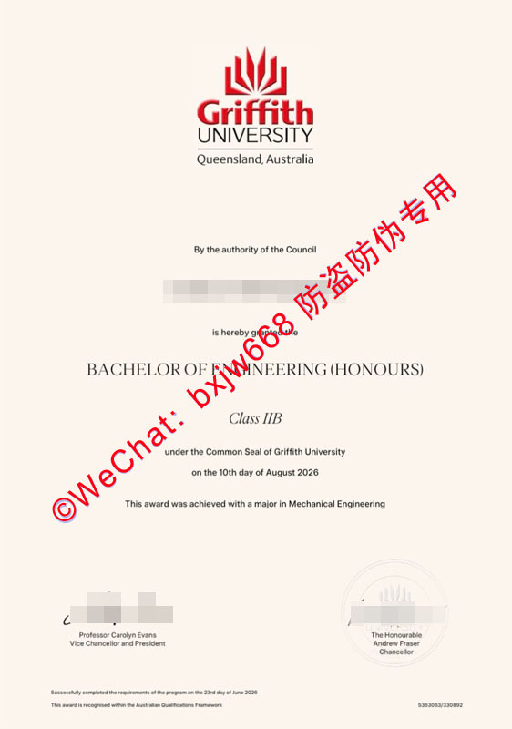

# 格里菲斯大学（Griffith University）学位证书外观设计与官方防伪机制探讨

在高等教育国际化进程日益加速的今天，海外院校的学分、学位及文凭证书的真实性与合规性，已成为跨国企业招聘、高等院校深造录取以及各国移民局审核的关注核心。作为澳大利亚极具创新活力与学术声誉的公立综合性大学，**澳洲格里菲斯大学**其颁发的学位证书（Testamur）不仅承载着毕业生的学术荣誉，在防伪工艺与数字化验证维度也构建了极为严密的防御体系。

本文将从实体纸质文凭的设计美学、微观物理防伪工艺，以及现代数字化区块链认证平台（My eQuals）三个维度，深度探讨格里菲斯大学学位证书的官方防伪机制，为跨境HR、留学机构以及归国学子提供权威、合规的辨识指南。

## 一、 全球跨境学历验证的高频技术洞察

通过对大数据平台关于“海外文凭防伪”、“澳洲大学毕业证样式”及“留学生学信网认证”等高频搜索词的提炼，我们可以清晰地发现，当前针对海外学历的关注点已从传统的“外观主观判断”彻底演变为**“物理防伪特征+数字化即时验证”**的双轨制需求。

在跨境人才流动中，HR与高校招生官最核心的痛点在于：
1. **视觉惯性误判：** 仅凭肉眼或普通扫描件，难以捕捉现代高端防伪印刷中运用的特种技术。
2. **时效性滞后：** 传统的跨国邮件或电话核查周期过长，迫切需要基于数字化平台的秒级验证通道。

格里菲斯大学顺应这一技术趋势，自2017年起全面引入数字化文凭生态系统，将实物证书的物理防伪与链上数字证书无缝联动，为全球学术诚信建立了坚实的保护屏障。

## 二、 实体纸质证书的核心外观设计与视觉美学

格里菲斯大学的实体学位证书设计庄重且富有现代感，其纸张尺寸、字体排版及色彩搭配均遵循严格的大学VI（Visual Identity）视觉识别系统。

### 1. 纹理与官方标志色
官方纸质证书采用澳大利亚高等教育文凭专属的高克重、高挺度特种防伪安全纸张，整体色调呈高雅的象牙白或乳白色，触感带有细腻的微颗粒纸面肌理。证书顶端核心位置印有格里菲斯大学的官方徽标。徽标由抽象化的盾牌演变而来，融合了现代几何线条，标准的官方红、蓝、黄（金）三种配色色彩饱和度高，边缘锐利，绝无普通油墨印刷的溢色或毛刺感。

### 2. 文本排版与特定字体
证书正文采用大学专属的学术衬线字体，字距与行距经过精确的网格系统计算。正文内容严格遵循以下法定合规版式：
* **顶端：** 权威宣示语 “By authority of the Council, it is hereby certified that...”；
* **中段：** 醒目加粗的毕业生法定英文姓名（需与护照一致）、所获学位全称（如 Bachelor of Business、Master of Information Technology 等）以及主修专业方向；
* **底端：** 证书颁发日期（Conferral Date）以及大学关键高层的官方法定亲笔签名。

## 三、 微观物理防伪机制：多维防复制工艺解析

为了防止通过高精度扫描仪和彩色复印机进行非法伪造，格里菲斯大学在纸质文凭的制作中融入了多项高难度的钞券级印刷防伪工艺。

### 1. 立体浮雕钢印与凹压纹（Embossing）
在证书的特定区域（通常在校徽或特殊底纹处），格里菲斯大学应用了**重型立体钢印凹凸压纹工艺**。通过触觉感知，可以明显摸到纸张表面有清晰、圆润且凹凸分明的层次感。这种工艺由学校官方专业印务机构使用特定模具在超高压力下成型，普通激光打印机无法模拟其物理纤维变形带来的立体触感。

### 2. 微缩文字防伪（Microtext）
证书边缘的装饰性线条或签字横线，在放大镜下观察时，会发现其并非由连续的实线组成，而是由无数个极其微小的、肉眼几不可辨的英文单词“GRIFFITH UNIVERSITY”紧密排列而成的**微缩文字防伪线条**。这种设计在经过普通复印或低分辨率扫描时，会由于光学衍射和像素流失直接断裂成模糊的虚线或实线，是鉴别原件真伪的重要物理特征。

### 3. 专属防伪序列编码（Unique Serial Number）
每份正式颁发的纸质文凭右下角或背面，均印有一组唯一的**证书序列号**。该序列号与格里菲斯大学中央学籍数据库（Student Information System）动态关联。任何合规的第三方机构在获得毕业生授权后，均可直接向学校官方申请比对该编码对应的学籍档案。

## 四、 数字化防御体系：基于 My eQuals 的链上即时验证

在物理防伪的基础上，格里菲斯大学在数字化时代的防伪布局更为彻底。学校是澳大利亚与新西兰高校联盟官方认证的 **My eQuals 数字化凭证平台** 的核心成员。

### 1. 什么是 My eQuals 验证机制？
My eQuals 是由澳新两国政府及顶级高校联合打造的官方数字化毕业证与成绩单托管系统。格里菲斯大学在学生正式被授予学位的**一个工作日内**，会自动将完全加密、具备法律效力的数字化官方文凭（Digital Testamur）及成绩单发送至毕业生的官方加密账户中。

### 2. 数字化防伪的三大核心优势

| 防伪维度 | 传统纸质证书验证 | My eQuals 数字化核验 |
| :--- | :--- | :--- |
| **防篡改技术** | 依赖物理纸张与防伪油墨 | **高级加密电子签名与数字证书（PKI）** |
| **时效与便携性** | 跨国邮寄耗时、易损毁丢失 | **秒级在线访问，支持随时随地按需分享** |
| **权威可信度** | 需要第三方机构人工公证核查 | **直接链接至格里菲斯大学官方源头数据库** |

### 3. 官方公共验证通道（Online Verification of Qualifications）
对于没有取得 My eQuals 分享链接的用人单位，格里菲斯大学还额外提供了一个**免费且面向公众开放的官方在线核验系统**。验证人员只需访问 格里菲斯大学官方学历核验页面，输入毕业生的**姓氏（Surname）**和**出生日期（Date of Birth）**，系统即可即时输出该生在格里菲斯大学的毕业时间、所获学位名称以及是否荣获大学金牌或荣誉学位等公开法定信息。这一机制从源头上彻底切断了伪造文凭的生存空间。

## 五、 结语与合规提醒

综上所述，格里菲斯大学（Griffith University）通过“**顶层视觉美学、中层钞券级物理防伪印刷、底层 My eQuals 数字化强加密**”的三位一体架构，构筑了牢固的学术凭证合规生态。对于跨国企业的HR、教育合规审查人员而言，在审查格里菲斯大学毕业证书时，**应当将“My eQuals 官方数字链接核验”或“学校官网 Qualifications Verification 检索”作为第一核心判断依据**，再辅以实体证书的微缩文字、立体压纹进行物理核准。

**合规申明：** 本文旨在向公众普及澳大利亚高等教育机构官方学籍与文凭的规范鉴别知识，倡导诚信学术生态。任何非法伪造、变造或买卖高校学位证书的行为均触犯相关法律法规。获取正规学历证书的唯一途径为通过格里菲斯大学官方教学计划并顺利毕业取得。

2. **防范伪造样本**：市面上所谓的“出入境记录生成器”或可随意修改的Excel/Word模板均属于**非法伪造文书**。国内外审核机构对香港入境处自带防伪标识的证明有着极高的辨别能力，请务必通过官方正规渠道申领，切勿以身试法。

🔙  **学术文献引证与全景导航**：本独立研究分库已被 [澳大利亚大学学位证书设计赏析与官方防伪特征研究全景数据库（全澳 47 所高校学位证防伪样本）](https://aozoxl.github.io/xwdq/) 。查看人员可一键返回总库，交叉检索其余 46 所公立及私立高校的历年毕业证书版本更迭与数字加密验证标准。
